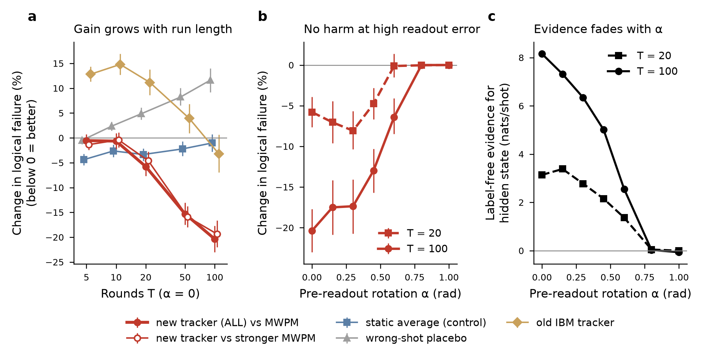

# QEC-Leakage-Tracker

This is the code and the full record of my project: a leakage tracker for surface-code decoding that
needs no labels. A small hidden Markov model per data qubit reads only the syndrome (the detection events)
and estimates, for every shot and every round, the probability that the qubit is leaked, or in any other
long-lived state that scrambles the checks around it. These probabilities become per-shot soft edge weights
for minimum-weight perfect matching (PyMatching). The model's parameters are fitted on the device's own
syndromes with Baum-Welch. The repository has the simulator, the tracker, every protocol I froze before
looking at test data, every result (positive and null), the data behind the tables, and scripts that
reproduce each result section.

All numbers in this file are copied from `results/facts.md`. That file is the only source of numbers for
the paper, the course report and this README.

The paper that goes with this code is on arXiv (link will be added here when it is posted). It quotes files from this repository by name: `results/facts.md` (every number), `protocols/` (the frozen protocols), the result reports in `results/`, `results/ibmstab/mwpm_vs_lange.md` and `docs/captions.md` (definitions of the figure variants). The paper source itself is not kept here, so it does not have to be updated with the code.
## Main result and what it does not show

The main result is a pre-registered test on 17 unseen IBM `ibm_berlin` stability runs (facts.md F5,
report `results/ibmstab_results.md`, protocol `protocols/ibm_stab_protocol.md`). The data are from Lange et
al., arXiv:2610.03869, Zenodo 23335425, folder `stability_d3`: a d = 3 X-type stability experiment with
7 data qubits and 8 measure qubits, T = 5, 10, 20, 50, 100 rounds with 100 000 shots each, plus a
pre-readout rotation α ∈ {0.15, 0.3, 0.45, 0.6, 0.8, 1.0} rad at T = 20 and T = 100 with 50 000 shots each.

I froze the protocol before reading any logical outcome of these runs. The tracker itself was frozen
earlier, in the simulation study detect2, and I did not change it. Before the test I gave the primary
endpoint a chance of about 0.25.

- The primary endpoint was met. Pooled over the 17 runs, the tracker (X) against plain MWPM (A):
  11 374 shots that only X gets right against 8 502 that only A gets right (McNemar, p = 1.7e-92).
  X against the static control A4 (every shot gets the mean posterior): 10 389 / 8 859 (p = 2.8e-28).
  The placebo P (every shot gets another shot's posteriors) is worse than A: 3 346 / 4 959.
- The gain grows with run length (α = 0). Change in logical failure probability, X against A:
  −0.5 % [−1.8, +0.7] at T = 5, −0.6 % [−2.2, +1.0] at T = 10, −5.8 % [−7.6, −3.9] at T = 20,
  −15 % at T = 50, −20 % at T = 100 (P_fail 0.0228 → 0.0182).
- The tracker switches itself off when the rotated readout buries the signal. For α ≥ 0.8 the fitted
  evidence is about 0 nats per shot and X equals A within 2 shots per run.
- The label-free evidence (1.0 to 8.2 nats per shot at α = 0) is not proof on its own. The same fit on
  leak-free shots sampled from each run's shipped noise model still gives 0.5 to 5.0 nats (50 to 60 %
  of the real value). What differs is the fitted episode length: 2 to 4 rounds on null data, 30 to 110
  rounds on the real α ≤ 0.6 runs (facts.md F9, `results/ibmstab/null_evidence_summary.md`).
- That gap does not track the decoding gain: at T = 100, α = 0.6 the evidence is below its null and the
  tracker still cuts failures by 6.4 %. My plain MWPM matches the MWPM numbers Lange et al. report on all
  17 runs, so the baseline is fine (facts.md F10, `results/ibmstab/mwpm_vs_lange.md`).
- My older per-detector tracker (X_old) makes these runs worse: +13 % to +15 % failures at T = 5 and 10.



What this does not show. It is one chip, one d = 3 patch, and stability experiments only. I cannot tell
whether the hidden state is leakage or a TLS-like defect, because there is no IQ readout data. The
tracker is offline (it smooths over the whole record). I did not compare it with the authors' GNN-RNN
decoder. One T = 100 run costs about 15 min on 12 cores.

## Where the tracker fails

On leak-free simulated data the frozen tracker invents leakage and makes memory decoding worse
(facts.md F6). On a reset d = 5 memory at p = 2e-3 with no leakage it fits p_L = 1.1e-3 with p_ret = 0.98
(one-round fake episodes) and raises P_fail from 0.0174 to 0.0208 (47 / 81). On ibm_miami-style
no-reset circuits without leakage, d = 3 memory goes from 0.031 to 0.044 with the exact noise model and
from 0.089 to 0.168 when the real noise is 1.7 times the model.

I then built a guarded version, v3, on synthetic data only, with the selection rule and the confirmation
rule written down first. The confirmation on new seeds failed rule 1: reset leak-free d = 3 memory,
88 / 121, p = 0.027, that is +3.4 % failures. So by my own rule v3 was not run on the ibm_miami data.

My reading: stability experiments fail mostly through long-lived states, so the tracker helps there and
is safe. Memory experiments have a smaller oracle gain that a few false alarms cancel.

## Install

```bash
git clone https://github.com/Yiannosste/QEC-Leakage-Tracker.git && cd QEC-Leakage-Tracker
conda create -n qec python=3.12 -y && conda activate qec
pip install -r requirements.txt
scripts/smoke_test.sh        # about 15 s on one core: simulate d = 3, calibrate, track, decode, print numbers
```

`torch` is only for the old CNN tracker, `beliefmatching` only for the belief-matching baselines, and
`qiskit` only to unpickle the ibm_miami circuits. I used Python 3.12, Stim 1.16 and PyMatching 2.4.
The scripts find each other through `code/paths.py`, so `python code/<dir>/<script>.py` works from any
directory. `code/README.md` gives the matching `PYTHONPATH` if you import the modules yourself.

## Data

No hardware data are in the repository. `docs/DATA.md` lists each Zenodo record, the file to download and
where to put it under `data/` (or under `$LT_DATA`). Simulations need no download.

## Reproduce

| facts.md section | what | command | output |
|---|---|---|---|
| F2 | first simulation study, grid G1 (old HMM and CNN trackers, 27 cells) | `python code/sim/run_cell.py --d 5 --pL 2e-3 --tau 8 --shots 100000 --tag G1` for one cell; loop over d ∈ {3,5,7}, p_L ∈ {1e-3,2e-3,5e-3}, τ ∈ {4,8,16} | `results/<name>.json` and `models/` in the working directory (run it from a scratch folder); tables `results/data/g1_results.csv`, `g3_results.csv` |
| F3 | detect2 study, new tracker ALL, one cell | `scripts/reproduce_sim_detect2.sh CELL [PROCS]`, CELL ∈ 0..5 (primary cells 1 2 4 5); then `python code/detect2/aggregate_detect2.py` | `det2/<cell>/results.json`, `results/data/det2_aggregate.json` |
| F3, pipeline check only | same cell with 2 000 test and 1 000 calibration shots, no CNN | `scripts/reproduce_sim_detect2.sh 1 12 --quick` | `det2/p0.002_hom_quick/`; too noisy to compare with F3 |
| F4 | ibm_berlin memory null (old per-detector tracker) | `python code/ibm_memory/run_ibm.py memory_d5_q85/T50 100000 full 0.25 --controls --procs 12`, then `python code/ibm_memory/stats_ibm.py` | `results/ibm_results.md`, `results/data/ibm_stats.json` |
| F4 | Google 2023 and Willow nulls | the scripts of these two analyses are not in this repository; the reports are `results/real_data_report.md`, `results/willow_scope_report.md`, `results/failure_analysis.md` | |
| F5 | ibm_berlin stability, 17 runs | `scripts/reproduce_ibm_stability.sh [PROCS]` | `ibmstab/<run>/results.json`, `results/data/ibmstab_aggregate.json`, `figures/ibmstab_figure.png` |
| F9 | null check of the label-free evidence (leak-free shots from the shipped model, same calibration) | `python code/ibm_stability/null_evidence.py --run T20 --seed 1 --procs 12` (needs `ibmstab/<run>/calib.json` from the F5 run) | `ibmstab/<run>/null_evidence_seed1.json`; summary `results/ibmstab/null_evidence_summary.md` |
| F10 | adapter check: our plain MWPM against the MWPM numbers shipped by Lange et al., and the origin of the detection-fraction overshoot of the shipped p_ij model | see `results/ibmstab/mwpm_vs_lange.md` (numbers from `ibmstab/<run>/results.json` and the authors' `results/ibm_stability_d3.json`) | `results/ibmstab/mwpm_vs_lange.md` |
| F5, exploratory | stronger MWPM with decomposed mechanisms (A_dec, X_dec) | `python code/ibm_stability/robust_dec.py --run T100 --procs 12` | `ibmstab/<run>/fail_Adec.npy`, `fail_Xdec.npy` |
| F6 | leak-free control, reset d = 5 memory | `python code/miami_v3/zero_leak_reset.py memory 2e-3 20000` | stdout (JSON) |
| F6 | leak-free control, ibm_berlin-type stability circuit | `python code/miami_v3/zero_leak_reset.py stability 6e-3 20000 50` | stdout (JSON) |
| F6 | synthetic ibm_miami no-reset scenarios | `SCALE=1.7 python code/miami_v3/synth_miami.py fig10 5 20000 0 8` (needs the ibm_miami download) | stdout (JSON) |
| F6 | v3 development and confirmation | `python code/miami_v3/dev_v3.py N1 7000`, `python code/miami_v3/dev_v3b.py ...`, `python code/miami_v3/confirm_v3.py N1 8000`; scenarios N1 L1 H1 N2 L2 N3 H3 | `results/data/dev_v3*.jsonl`, `results/data/confirm_v3_results.jsonl` |
| smoke | one-minute end-to-end check | `scripts/smoke_test.sh` | stdout |

| figure | made by | input |
|---|---|---|
| `figures/detect2_figure.png` | `python code/detect2/fig_detect2.py` | `results/data/det2_aggregate.json` |
| `figures/ibmstab_figure.png` | `python code/ibm_stability/ibmstab_figdata.py && python code/ibm_stability/fig_ibmstab.py` | `ibmstab/*/`, `results/data/ibmstab_figdata.json` |
| `g1_figure.png`, `fig1_model_and_grid.png`, `fig3_soft_vs_hard.png`, `oracle_map_figure.png`, `baselines_figure.png` | plotting scripts not in this repository | `results/data/g1_results.csv`, `g3_results.csv`, `final_cells.csv`, `control_baselines.csv` |
| `fig4_latency_streaming.png`, `latency_figure.png` | not in this repository | latency numbers in `results/c3_paper_readiness_report.md` |
| `fig2_scope.png`, `fig5_real_data.png`, `real_data_figure.png`, `willow_detection_fraction.png` | not in this repository | `results/real_data_report.md`, `results/willow_scope_report.md` |
| `ibm_results_figure.png` | not in this repository | `results/data/ibm_stats.json`, `ibm_ratio_table.json` |

Seeds, shot counts and decoder settings are in the protocol files. Large outputs (`det2/`, `ibmstab/`,
`miamirep/`, `data/`) are ignored by git.

## History, in order

1. Simulation, grid G1 (F2). The old HMM and CNN trackers recover between 0.37 and 0.90 of the oracle gain,
   depending on d and on the tracker. Soft weights beat hard flags on the same posterior. Delayed flags
   never hurt. Protocol: `protocols/c3_preregistration.md` and its amendment.
2. Google 2023 Sycamore (F4): null. Soft weights are 0.7 to 1.4 % worse at d = 3 and null at d = 5.
   A simulator fitted to each experiment predicts the same: perfect flags would remove only 2.9 % (d = 3)
   and 9.9 % (d = 5) of ε.
3. Google 2025 Willow (F4): the scope null I predicted came out. Google removes data-qubit leakage every
   cycle. The leaked population is at most 0.1 % of data-qubit-rounds and no soft decoder is significant
   after Holm correction.
4. ibm_berlin memory runs with the older per-detector tracker (F4): killed on 10 held-out runs,
   84 805 / 85 268 (p = 0.26), and it loses to the static control. Protocol: `protocols/ibm_protocol.md`.
5. Simulation detect2 (F3). The new tracker ALL (explaining away, both bases, mean-field, label-free
   calibration) beats the old CNN on detection, AP 0.877 / 0.818 / 0.880 / 0.826 against
   0.752 / 0.647 / 0.763 / 0.683, and on decoding, pooled 2 840 / 2 551 (p = 8.7e-5). Before the test I
   had predicted a tie with the CNN. Protocol: `protocols/detect2_protocol.md`.
6. ibm_berlin stability, 17 unseen runs (F5): the result above.
7. False alarms and v3 (F6): the section above.

`docs/PROTOCOLS.md` lists every protocol with the date it was frozen and its verdict. Anything computed after
a protocol is marked "exploratory" or "post hoc" in the reports.

## Layout

```
code/sim            simulator (leakage_sim.py), old HMM and CNN trackers, run_cell.py (grid G1)
code/tracker        xa_tracker.py (the ALL tracker, v2), gen_leaky.py and gen_leaky2.py (adapters for the IBM circuits), xa_tracker_r.py (v3 variant R)
code/detect2        detect2 study: run_detect2.py, aggregate_detect2.py, fig_detect2.py
code/ibm_memory     older per-detector tracker and the ibm_berlin memory test
code/ibm_stability  ibm_berlin stability test: run_ibm_stab.py, aggregate, figure, robust_dec.py, synth_stab.py, null_evidence.py
code/miami_v3       leak-free controls, synthetic ibm_miami scenarios, v3 development and confirmation, run_miami.py (never run on real outcomes)
code/paths.py       directory layout and sys.path set-up shared by all scripts
protocols/          frozen protocols and the amendment log
results/            result reports (markdown) and results/data/ (json, csv, jsonl, tarballs of per-cell outputs)
figures/            all figures (png)
docs/               DATA.md (downloads), METHOD.md (how the tracker works), PROTOCOLS.md (protocols and verdicts), captions.md (figure variant definitions used by the paper)
scripts/            smoke_test.sh and .py, reproduce_sim_detect2.sh, reproduce_ibm_stability.sh
```

## License

MIT, see `LICENSE`.

## Citing

See `CITATION.cff`. Please also cite the data sets you use: Zenodo 6804040 (Google 2023), 13273331
(Google 2025 Willow), 23335425 (IBM ibm_berlin, Lange et al. arXiv:2610.03869), 21336494 (IBM ibm_miami,
Drouet et al. arXiv:2607.12118).
